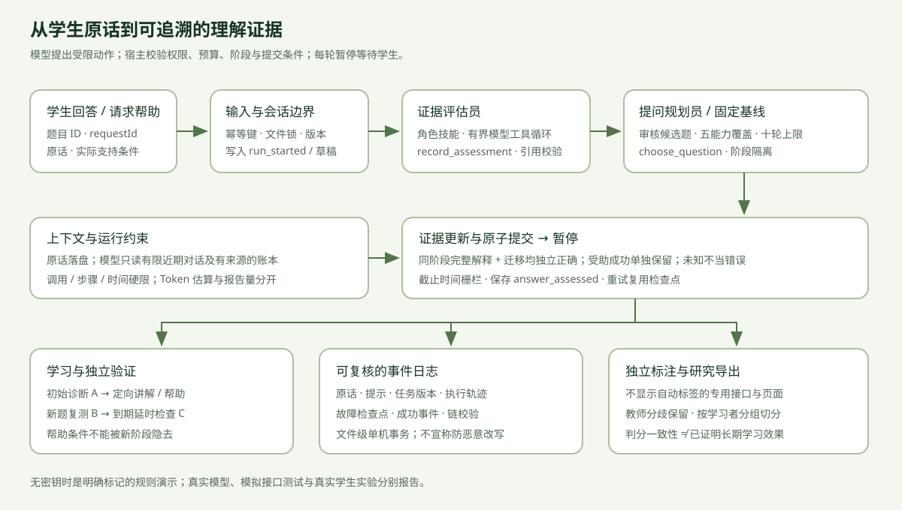

# MasteryMap · Evidence-first Education Agent Harness

用学生的自然语言解释收集理解证据，按实际帮助条件区分独立与受助表现，再通过新情境复测和延时检查验证。本项目围绕“过拟合与泛化”做小范围研究 Demo，包含可检查的模型工具循环、持久运行记录、独立标注与数据导出。



这张图展示一次作答如何经过输入与权限边界、评估员、提问规划员、状态校验和原子提交，然后暂停等学生回答。底部将教学验证、运行证据和人工标签分开，避免把课程生成完成误认为学生学会。

## 快速体验

Node.js 18+，无第三方运行依赖：

```bash
npm start
```

打开 **http://127.0.0.1:4173**。原版选择题学习地图保留在 `/index.html`。

无密钥时能走完规则演示流程，页面、每轮记录及导出均标明 `offline-rules`。关键词规则不理解语义，不能作为真实掌握判断或教师标签。配置模型后使用原生 tools 协议；模型失败会保留检查点，不会偷偷降级为规则。

复制 `.env.example` 为 `.env` 后填写：

```text
DEEPSEEK_API_KEY=你的密钥
ASSESSMENT_MODEL=deepseek-chat
PLANNER_MODEL=deepseek-chat
PORT=4173
```

自部署模型可设置 `ASSESSMENT_BASE_URL`（完整 chat/completions 地址）和 `ASSESSMENT_API_KEY`，需支持原生 tool calls。规划员与评估员可用不同模型名称，但共享该接口和密钥。密钥仅服务端读取；真实模型调用会发送任务标准、当前回答、帮助条件和有限历史。接口必须HTTPS，本机开发模型允许HTTP。

## 本轮能力

- 五个细粒度能力：泛化差距、复杂度与噪声、早停、正则化、数据划分。
- 35道任务：A诊断15道、B即时复测10道、C延时检查10道。诊断最多10轮，证据不够时保留未知。
- 固定顺序/自适应两种策略、匿名学习者代号，支持对照和按学习者切分数据。
- 方向、步骤、别例三档提示；实际提供的帮助随作答保存。受助答对不算独立通过。
- 同阶段完整解释与迁移双门槛，短追问不替代完整解释。证据分是描述性分数，不是掌握概率。
- 定向讲解、撤去提示的新题复测；默认24小时后学习者可主动回来做延时检查。没有后台提醒。
- 两个顺序模型角色，工具白名单、技能、上下文账本、步骤/调用/时间限制、运行轨迹、原子日志、幂等与检查点恢复。
- 专用独立标注页不显示模型标签；多人标注事件、评测脚本与人工标签训练数据导出。

诊断期间不显示解析；即时复测两题完成前不反馈；延时整批完成前不显示该批自动评估。初始诊断与后续阶段分别保存。延时批次开始后不再在同一会话新增教学，新的补学另开会话。

## Harness 结构与参考

| 部分 | 入口 |
| --- | --- |
| 完整架构、角色工具、记忆、预算、恢复与边界 | [docs/HARNESS.md](docs/HARNESS.md) |
| OpenMAIC、learn-claude-code、Claude Code来源及许可 | [docs/REFERENCES.md](docs/REFERENCES.md) |
| 课程、审核任务、标准与帮助 | `lib/curriculum.js`、`education-skills/` |
| 模型循环、上下文、技能、deadline和日志 | `lib/harness/` |
| 会话与研究HTTP协议 | `lib/dialogue.js` |

参考 OpenMAIC 的教学与独立复核、learn-claude-code 的工具循环/技能/上下文/任务运行机制，以及 Claude Code 官方公开的扩展契约。本轮没有复制这些项目的实现代码。Claude Code 官方公开仓库不等于完整核心源码；本项目也不是它的复刻。详细来源固定版本与证据限制见参考文档。

## 记录、独立标注与研究数据

会话在本机 `data/sessions/<UUID>.jsonl` 保存；数据目录、密钥与临时文件不提交Git。浏览器只记会话编号、草稿和重试编号。开始新会话不会覆盖旧日志。旧三能力会话可读、可导出，新流程另开会话。

“导出完整记录”包含被接受的作答、帮助、模型来源与版本、运行轨迹、教学、人工标签。失败运行和检查点不冒充成功作答。原始日志及导出分别有一致性校验链；这不是抵御有本地写权限者的认证机制。

完成阶段后可打开“独立人工标注”。研究时让另一标注者直接访问 `http://127.0.0.1:4173/?review=<UUID>`，专用接口不提供自动标签；进入此页不能抹去一个人之前看过自动结果的事实，因此不能称为双盲实验。标签是标注者自报，系统不认证其教师身份。

```bash
# 逐轮判分、掌握标签、帮助条件与策略分组评测
npm run evaluate -- /absolute/path/session.jsonl

# 将符合条件的独立人工标签转成评估员SFT数据，按学习者/会话分组切分
npm run dataset -- --out /absolute/path/dataset /absolute/path/session.jsonl
```

没有人工标签不生成虚假的准确率。模型自动判分不能当人工gold；多人分歧需要保留。导出生成的manifest说明跳过项、来源、切分和边界。默认按学习者（没有代号则按会话）分组，同一个人跨多个会话时应使用同一匿名代号，否则无法识别潜在泄漏。

导出的监督目标是人工提供的 `correctness/evidenceQuote/note` 判分子任务，不能直接替换在线角色。在线接口还要求原生tool calls和完整六字段评估协议；部署微调模型前需补充相应人工字段、工具协议训练与适配验证，不能用自动判断偷偷补成标签。

固定/自适应策略比较只提供研究数据入口；未经随机或合理匹配的学生实验，组间差异不是因果效果。真实学生、模拟模型响应、合成测试样例需要分别报告。项目没有训练新权重，也没有真实学生准确率或长期学习效果结论。

## 运行恢复与限制

作答重试绑定 `requestId + taskId + 输入hash`。已提交的同一请求不重复计分；失败会保留原题、原答复、已完成评估及预算。模型/工具超时后迟到结果不能提交新作答。用量或上下文耗尽会停止本轮，保留导出和新建入口。

进程硬退出可能留下锁。先停止所有使用此目录的服务，再运行以下命令，之后重新启动并用原提交编号恢复：

```bash
npm run recover -- --offline
```

该命令只清理已停止进程的锁文件，不改变学生证据。日志是同机小规模文件存储，未实现多用户认证、集群调度或网络文件系统租约；服务默认仅监听 `127.0.0.1`。

## 验证

```bash
npm run check
npm test
```

测试覆盖课程和阶段门槛、帮助条件、原生工具协议、越权、预算、超时、引用、幂等、持久恢复、原子写失败、日志降级、盲接口、标注分歧与数据切分。GitHub Actions在Node 20/22运行检查。模拟接口测试不等同于真实模型实测；真实模型与学生研究结果需另行登记。
